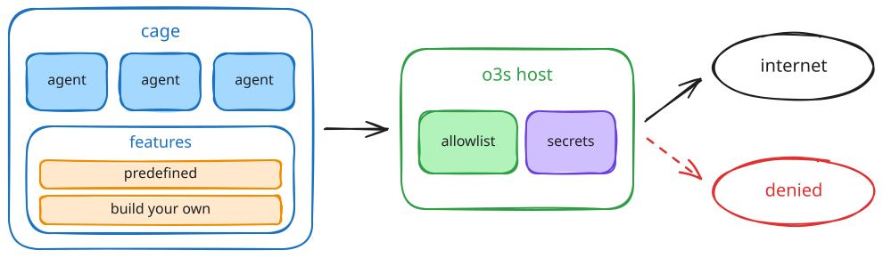

<p align="center">
  
</p>

<h1 align="center">o3s</h1>

<p align="center">
  <b>Everything ready. Everything parallel. Everything locked down.</b>
</p>

<p align="center">
  <picture>
    <source media="(prefers-color-scheme: dark)" srcset=".github/assets/architecture-dark.excalidraw.svg">
    
  </picture>
</p>

<p align="center">
  
  
  
  
  
  
  
  
  
  
  
</p>

If you are not willing to trade security for productivity, o3s is a match. Let an agent generate every line of code, and review every line by hand or none at all. Either way, the features that shape your agents' environment, the hosts they reach and the secrets they can read stay yours to decide.

[Anthropic][ref] and [OpenAI][cdx] both ship a reference devcontainer, deliberately minimal: Anthropic's applies a short hardcoded allowlist from inside the container, and OpenAI's tells you to add your own DNS filtering. o3s starts where they stop: productivity on steroids, and deterministic enforcement (harness) to get there.

We created o3s to keep pace: trusted environments, several projects at once, and several features inside each. AI will not be the death of good engineering. It is the golden era of agentic software engineers. This is how we build with it and still stand behind every line that ships.

## Commands

Run `o3s` alone for a menu that leads through each of them.

**firewall**
```sh
# Allows the hosts the cage may reach, for good or for a set time
o3s firewall add github.com --port 22 --port 443 --for 1h
```

**secret**
```sh
# Lets the cage use a secret while its value stays on the host
echo "$EXAMPLE_TOKEN" | o3s secret add EXAMPLE_TOKEN
```

**feature store**
```sh
# Selects where the cage's tools come from, curated, reproducible and locked down
o3s feature store add ghcr.io/hansehart/devcontainer-features
```

**feature**
```sh
# Installs a tool properly, pinned and wired to its hosts, env and config
o3s feature add ghcr.io/hansehart/devcontainer-features/claude-code
```

**project**
```sh
# Clones a repository into ~/projects in the cage and adds it to the workspace
o3s project add torvalds/linux
```

**cage**
```sh
# Opens a shell in the home's VM, where the home and its cage live
o3s cage shell --vm
```

**update**
```sh
# Brings the binary, its images, the stack and your features forward
o3s update
```

## Getting started

**Prerequisites:** Linux or macOS on amd64 or arm64, QEMU on Linux, which runs the VM through [Lima](https://lima-vm.io) the installer brings along, [VS Code](https://code.visualstudio.com/download) with the [Dev Containers extension](https://marketplace.visualstudio.com/items?itemName=ms-vscode-remote.remote-containers), and tar and xz. A home without its VM runs on [Docker](https://docs.docker.com/engine/install/) with Compose.

1. Install o3s.
   ```sh
   curl -fsSL https://github.com/hansehart/o3s/releases/latest/download/install.sh | sh
   ```
2. Create your home.
   ```sh
   mkdir ~/o3s && cd ~/o3s && o3s init
   ```
3. Step into its VM and open the cage there.
   ```sh
   o3s cage shell --vm
   cd ~/o3s && o3s cage shell
   ```
   A home without its VM, made with `o3s init --dangerously-skip-vm`, opens straight from this machine.
   ```sh
   # VS Code
   o3s cage ide
   ```
   or
   ```sh
   # Terminal
   o3s cage shell
   ```

> [!WARNING]
> Only `~/features`, `~/o3s`, and `~/projects` survive a rebuild in the cage. Keep your work in `~/projects`, where `o3s project add` puts it.

## What you get

### Security

Your security model lives in one file, which hosts the cage reaches and which secrets it uses. Their values stay on the host, and the proxy injects them on the way out.

```jsonc
{
  "$schema": "./.devcontainer/o3s.schema.json",
  "stores": [
    { "id": "ghcr.io/devcontainers/features" },
    { "id": "ghcr.io/hansehart/devcontainer-features" }
  ],
  "hosts": [
    // yours
    { "name": "github.com", "ports": [22, 443], "by": ["user"] },

    // claude-code
    { "name": "api.anthropic.com", "ports": [443], "secret": "ANTHROPIC_API_KEY", "inject": ["header"], "by": ["ghcr.io/hansehart/devcontainer-features/claude-code"] },
    { "name": "platform.claude.com", "ports": [443], "by": ["ghcr.io/hansehart/devcontainer-features/claude-code"] },

    // docker-in-docker
    { "name": "*.docker.io", "ports": [443], "by": ["ghcr.io/hansehart/devcontainer-features/docker-in-docker"] },
    { "name": "production.cloudfront.docker.com", "ports": [443], "by": ["ghcr.io/hansehart/devcontainer-features/docker-in-docker"] },

    // go
    { "name": "proxy.golang.org", "ports": [443], "by": ["ghcr.io/hansehart/devcontainer-features/go"] },
    { "name": "sum.golang.org", "ports": [443], "by": ["ghcr.io/hansehart/devcontainer-features/go"] },

    // rust
    { "name": "index.crates.io", "ports": [443], "by": ["ghcr.io/hansehart/devcontainer-features/rust"] },
    { "name": "static.crates.io", "ports": [443], "by": ["ghcr.io/hansehart/devcontainer-features/rust"] },
    { "name": "static.rust-lang.org", "ports": [443], "by": ["ghcr.io/hansehart/devcontainer-features/rust"] }
  ]
}
```

### Productivity

Several agents work side by side, each on its own branch or worktree. Everything lands in one view for you to review.

```json
{
  "folders": [
    { "name": "o3s", "path": "/home/ubuntu/o3s" },
    { "name": "eval-harness", "path": "/home/ubuntu/projects/eval-harness" },
    { "name": "inference-engine", "path": "/home/ubuntu/projects/inference-engine" },
    { "name": "inference-engine.worktrees", "path": "/home/ubuntu/projects/inference-engine.worktrees" },
    { "name": "triton-kernels", "path": "/home/ubuntu/projects/triton-kernels" },
    { "name": "triton-kernels.worktrees", "path": "/home/ubuntu/projects/triton-kernels.worktrees" },
    { "name": "wafer-scale-compiler", "path": "/home/ubuntu/projects/wafer-scale-compiler" }
  ]
}
```

### Velocity

Fail fast, fix faster, ship fastest. Your agents see every repository at once, the best context they can get. With rootless Docker and minikube they run your whole stack inside the cage, break it and bring it back without touching anything real.

```json
{
  "features": {
    "ghcr.io/hansehart/devcontainer-features/claude-code:3": {
      "stateDir": "/home/ubuntu/features/ghcr.io/hansehart/devcontainer-features/claude-code"
    },
    "ghcr.io/hansehart/devcontainer-features/docker-in-docker:4": {
      "stateDir": "/home/ubuntu/features/ghcr.io/hansehart/devcontainer-features/docker-in-docker"
    },
    "ghcr.io/hansehart/devcontainer-features/go:2": {
      "stateDir": "/home/ubuntu/features/ghcr.io/hansehart/devcontainer-features/go"
    },
    "ghcr.io/hansehart/devcontainer-features/rust:2": {
      "stateDir": "/home/ubuntu/features/ghcr.io/hansehart/devcontainer-features/rust"
    }
  }
}
```

## References

> [!TIP]
> Is o3s worth your limited time? Decide on your security model:
>
> **My agent is actively malicious and tries to escape**\
> ❌ No, a VM boundary is stronger than containers.
>
> **My long-leash-but-not-weaponized agent needs deterministic boundaries**\
> ✅ Yes, the architecture delivers security coupled with convenience.

See the [comparison](https://agentic-software-engineers.com/docs/o3s/comparison) for others working on the same problem.

Something here you would do differently? Open an issue, send a pull request, or just get in touch. And if one of the others fits you better, take it, as long as you keep both your security and your productivity. You are always welcome back.

## What the name means

<table align="center" width="80%">
  <tr>
    <td width="50%" valign="top" align="center">
      
      <p>Read every line, shape it however you like, and make the whole setup truly your own to trust and extend.</p>
    </td>
    <td width="50%" valign="top" align="center">
      
      <p>Give AI agents and untrusted code a long leash while you control the network they reach and the secrets they read.</p>
    </td>
  </tr>
</table>

<table align="center" width="80%">
  <tr>
    <td width="50%" valign="top" align="center">
      
      <p>Built for engineers and their agents to take your whole stack from prototype to production with minimal friction.</p>
    </td>
    <td width="50%" valign="top" align="center">
      
      <p>Agents, containers, languages, and all your projects, wired together into one platform you just open and use.</p>
    </td>
  </tr>
</table>

<p align="center">
  open secure software suite, or osss, shortened to o3s.
</p>

[ref]: https://github.com/anthropics/claude-code/tree/d945a61bc6346abce607252d5667df8a3bf0461a/.devcontainer
[cdx]: https://github.com/openai/codex/tree/900b1e4cec1c4eada106a8071fc89c11c50de9a6/.devcontainer
